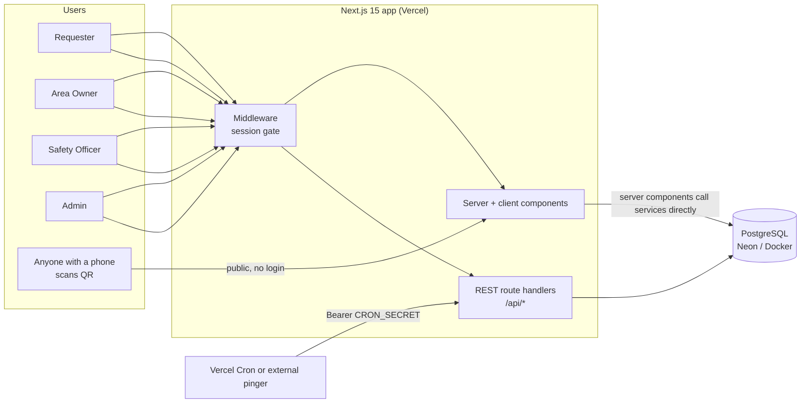
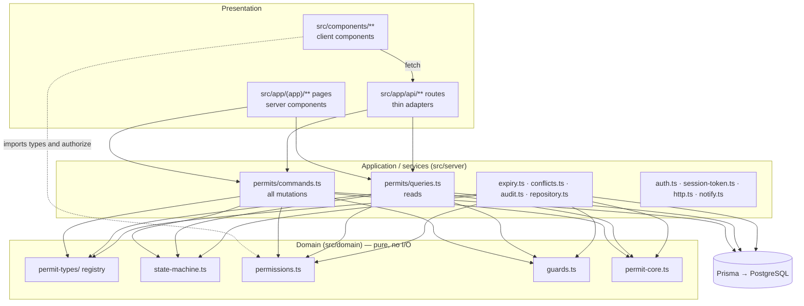
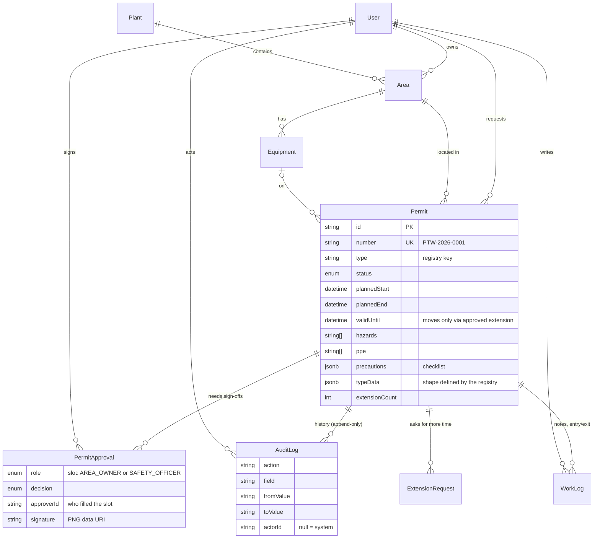
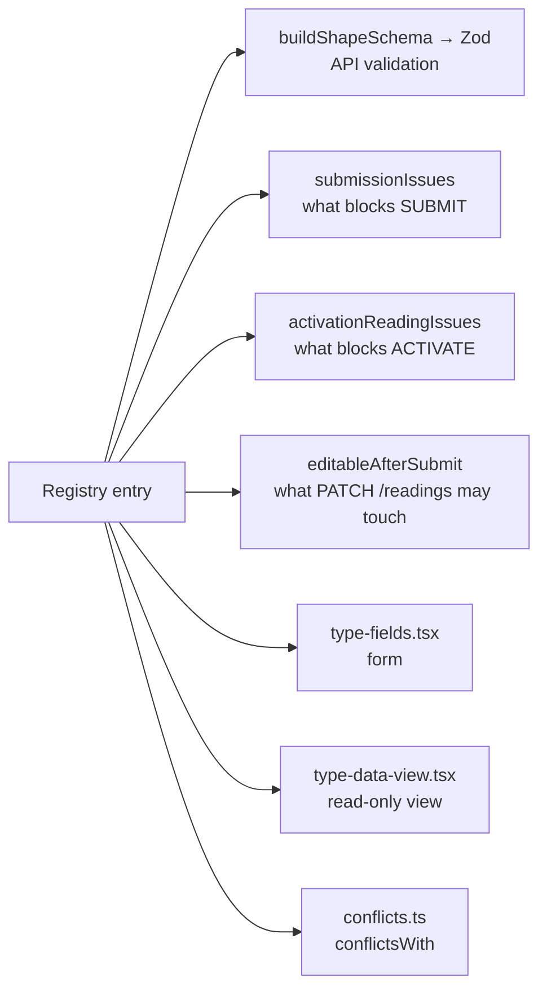
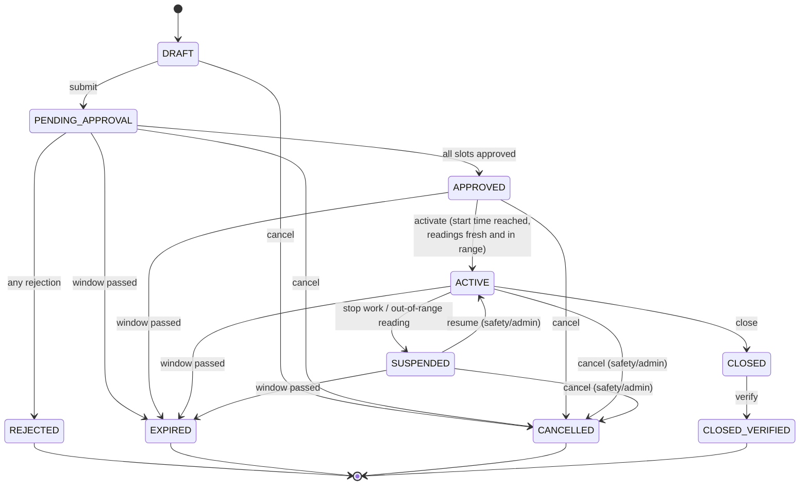
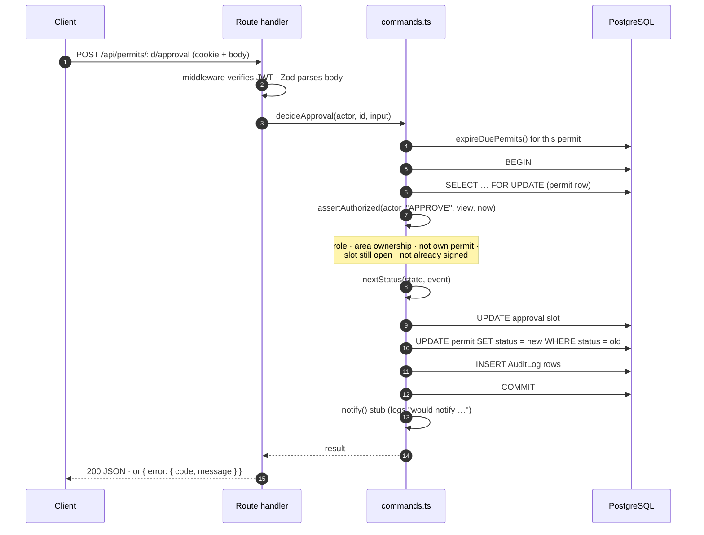
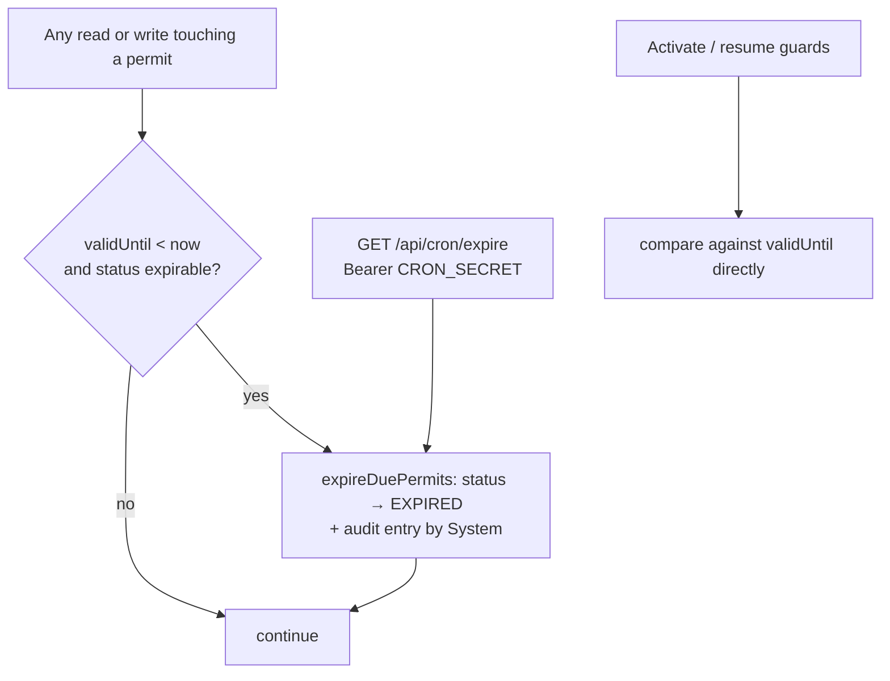
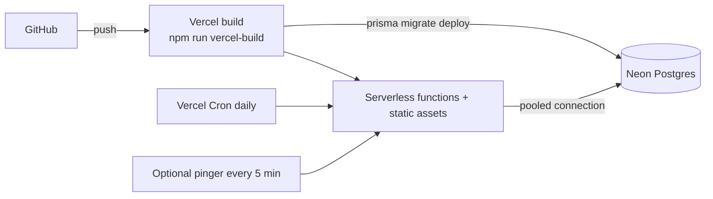

# Architecture

How the Permit to Work (PTW) module is put together, and why. The README covers setup and product decisions. This document covers structure: layers, data, request flow, and the invariants the code protects.

- [1. Goals and constraints](#1-goals-and-constraints)
- [2. System context](#2-system-context)
- [3. Layers and dependency rules](#3-layers-and-dependency-rules)
- [4. Data model](#4-data-model)
- [5. The permit-type registry](#5-the-permit-type-registry)
- [6. The permit lifecycle](#6-the-permit-lifecycle)
- [7. Anatomy of a command](#7-anatomy-of-a-command)
- [8. Authorization](#8-authorization)
- [9. Audit trail](#9-audit-trail)
- [10. Time and expiry](#10-time-and-expiry)
- [11. Concurrency](#11-concurrency)
- [12. Authentication and sessions](#12-authentication-and-sessions)
- [13. Frontend structure](#13-frontend-structure)
- [14. Testing strategy](#14-testing-strategy)
- [15. Deployment topology](#15-deployment-topology)
- [16. Extension guides](#16-extension-guides)
- [17. Trade-offs and known limits](#17-trade-offs-and-known-limits)

---

## 1. Goals and constraints

| Goal | How the design serves it |
|---|---|
| **Safety rules can't be bypassed** | Every rule is enforced on the server inside one transaction. The UI only mirrors the rules and is never the enforcement point. |
| **Add a permit type without touching the core** | Type-specific fields are data in a registry. Forms, validation, approvals and conflicts are all derived from it. |
| **Evidence you can trust** | The audit log is written in the same transaction as the change it describes, and Postgres blocks edits to it. |
| **Correct with nobody watching** | Expiry is decided from timestamps on every read and write, and also by a scheduled sweep. |
| **Easy to review** | Business rules are pure TypeScript with no I/O, in about 400 lines under `src/domain`. |

Non-goals: real notifications, multi-tenant isolation, offline mode, a document store for signatures.

## 2. System context

One deployable unit. Server components read through the same query layer the API uses, so a page and the equivalent API call can't disagree.

## 3. Layers and dependency rules

**Rules**

1. `src/domain` imports nothing from `server`, `app`, `components`, Prisma or React. It runs in the browser, on the server and in unit tests with no setup.
2. Only `src/server` talks to the database. `server-only` is imported there so a client bundle can't pull it in by accident.
3. Route handlers contain no business logic. They parse input with Zod, call one command or query, and map the result or error to JSON.
4. Client components never hold rules of their own. They ask the server what is allowed.

## 4. Data model

Key choices:

- **One `Permit` table.** The columns every permit has are real columns. Anything type-specific goes in `typeData` (JSONB). See [section 5](#5-the-permit-type-registry).
- **`validUntil` is separate from `plannedEnd`.** `plannedEnd` records what was approved. `validUntil` starts equal to it and moves only when an extension is approved. Expiry always compares against `validUntil`.
- **Approvals are slots.** On submit, one `PermitApproval` row is created per role the type requires (`@@unique([permitId, role])`). `role` is the slot and `approverId` is whoever filled it. This is how "two different people must sign" is checked.
- **Indexes** match the hot queries: `(status, validUntil)` for the expiry sweep and the "expiring soon" tile, and `(areaId, plannedStart)` for conflict detection and the site timeline.
- **Permit numbers** (`PTW-<year>-<seq>`) are allocated under a transaction-scoped advisory lock, so concurrent creates can't produce duplicates.

## 5. The permit-type registry

`src/domain/permit-types/` holds one file per type and an `index.ts` that registers them. A type is a plain object:

| Property | Drives |
|---|---|
| `key`, `label` | Identity in the DB and the UI |
| `requiredApprovals` | Which approval slots are created on submit |
| `maxDurationHours` | Validity cap (one shift or more) |
| `conflictsWith` | The simultaneous-operations rule, in both directions |
| `fields[]` | Validation, form rendering, read-only view, activation checks |
| `defaultHazards`, `defaultPpe`, `precautions` | Pre-filled content and the precautions checklist |

Each **field** descriptor carries `kind` (text, number, select, datetime, boolean…), `requiredFor` (`"submit"` or `"activate"`), `safeRange`, `maxAgeMinutesAtActivation`, and `editableAfterSubmit`.

Because every consumer reads the same descriptor, adding or changing a type never requires parallel edits in five places.

## 6. The permit lifecycle

Three independent checks guard every move. A transition happens only if all three pass:

| Check | File | Question | Failure |
|---|---|---|---|
| Graph | `state-machine.ts` | Does this edge exist? | `409 INVALID_TRANSITION` |
| Permission | `permissions.ts` | Is this person allowed to do this, to this permit, in this state? | `403 FORBIDDEN` |
| Precondition | `guards.ts` | Is it the right time, with the right data? | `409 PRECONDITION_FAILED` |

The state machine is a transition table (`event → { from: states[], to: state }`), so its tests can enumerate every state and event pair and prove the illegal ones are absent. The system fires `APPROVE_ALL` when the last slot is signed and `EXPIRE` when `validUntil` passes. The diagram above draws those as plain edges.

## 7. Anatomy of a command

Every mutation in `server/permits/commands.ts` has the same shape. The example is an approver signing:

Properties that fall out of this shape:

- **No half-writes.** The status change, approval row and audit entries commit together or not at all.
- **No stale decisions.** The row lock plus the conditional `UPDATE … WHERE status = old` mean a decision is made against the state that will actually be written.
- **One place to look.** To know every way a permit can change, read one file.
- **Typed failures.** `DomainError` (code, message, details) is the only error the domain throws. `http.ts` maps codes to status codes, so routes never decide status codes themselves.

## 8. Authorization

`authorize(actor, action, permit, now)` in `permissions.ts` is a pure function that returns `{ allowed: true }` or `{ allowed: false, code, reason }`. Both the API and the UI call it.

- **API:** `assertAuthorized` throws the matching `DomainError` before anything is written.
- **UI:** the detail query returns `allowedActions` for the current user, and the action panel renders only those. When an action is blocked by a precondition rather than a role, the same function supplies the human-readable reason.

The rules sit on three axes: the actor's role, their relationship to the permit (requester, owner of this area, neither), and the permit's state. Role and area ownership are loaded fresh from the database on each request, so a demotion takes effect immediately.

| Principle | Where it shows up |
|---|---|
| Never approve your own permit | Checked for every role, admin included |
| Two signatures means two people | One person can't fill both slots, admin included |
| Area owners act only in their own area | `ownedAreaIds` is compared to `permit.areaId` |
| Anyone on site can stop work, only a competent person can restart | `SUSPEND` has a broad actor set, `RESUME` is safety/admin only |

## 9. Audit trail

- Entries are inserted by `server/permits/audit.ts` inside the command's transaction.
- They cover state changes, approvals and rejections, extension requests and decisions, simultaneous-operations warnings recorded on submit, and every post-submission field edit (with `fromValue` and `toValue`).
- `actorId = null` means the system (auto-expiry, auto-suspend).
- Migration `…_audit_log_immutable` adds `BEFORE UPDATE` and `BEFORE DELETE` triggers that raise an exception. A bug in the app, or an admin using the app's DB role, can't rewrite history.
- The UI renders the log as a sentence timeline, not JSON.

Limit: the DB owner can still drop the trigger or `TRUNCATE`. In production the app should connect as a role without those privileges.

## 10. Time and expiry

All timestamps are stored in UTC and displayed in IST. Expiry doesn't depend on a timer running.

Three layers, each covering a gap in the others:

1. **Sweep on access:** `expireDuePermits()` runs before reads and writes. Nobody sees or acts on an overdue permit as if it were live.
2. **Scheduled sweep:** a cron route writes the expiry (and audit entry) close to the real time when nobody is using the app.
3. **Guard comparison:** activation and resume compare against `validUntil` directly, so even between sweeps nothing starts late.

The countdown in the browser is cosmetic. At zero the page reloads and shows what the server decided.

## 11. Concurrency

| Hazard | Mitigation |
|---|---|
| Two approvers sign at once | `SELECT … FOR UPDATE` on the permit row serialises them. The second sees the updated state. |
| Approval races a cancel | Same lock. One wins, the other gets `409`. |
| Two permits created at once get the same number | `pg_advisory_xact_lock` around number allocation |
| Stale status written | Conditional `UPDATE … WHERE status = <read value>` |
| Sweep races a user action | Both go through the same lock and conditional update |

The e2e suite includes a case where two users act at the same moment.

## 12. Authentication and sessions

- Login: email and password, compared with bcrypt. A dummy hash is compared for unknown emails so response time doesn't reveal which accounts exist.
- Session: an HS256 JWT in an `httpOnly` cookie, containing only the user id (12 h).
- `middleware.ts` is a coarse gate that rejects requests with no valid session (login page redirect for pages, `401` for the API). Public paths are login, cron (own bearer check) and `/status/*` (the QR page).
- `getCurrentUser()` then loads the user and owned areas from the DB on every request and rejects inactive users. Fine-grained authorization happens in the domain layer, never in middleware.
- Signing and verifying live in `session-token.ts`, which has no DB or Node-only imports, so middleware (edge runtime) can use it.

## 13. Frontend structure

- **Server components by default.** Pages fetch through `server/permits/queries.ts`, so most screens ship little JavaScript.
- **Client components only where interaction needs them:** the multi-step form, signature pad, action panel, countdown, filters.
- **Mutations** go through `components/use-mutation.ts` and `lib/api-client.ts`, which call the REST API and surface the server's error message verbatim.
- **Type-driven rendering:** `type-fields.tsx` and `type-data-view.tsx` render any permit type from its registry fields.
- **Status presentation:** `badges.tsx`, `lifecycle-stepper.tsx`, `reading-meter.tsx`, `site-timeline.tsx` and `approval-trail.tsx` are small presentational pieces fed with server data.
- **Public QR page** (`app/status/[id]`) shows only status text and a countdown, never names.
- **Mobile-first:** large touch targets, a persistent STOP WORK action on active permits, and a sticky action bar in the form.

## 14. Testing strategy

| Layer | Location | What it proves | DB needed |
|---|---|---|---|
| Unit | `tests/state-machine.test.ts`, `permissions.test.ts`, `permit-types.test.ts` | The graph has no illegal edges. Permission matrices hold for every role and state. Registry fields validate and bound correctly. | No |
| Integration | `tests/integration/permit-flow.test.ts` | The real services against Postgres: full lifecycle, self-approval for each role, area ownership, activation rules, expiry, audit-log immutability, auto-suspend, confined-space register, conflicts, concurrent numbering | Yes (`ptw_test`, auto-created) |
| End-to-end | `tests/e2e/api.e2e.ts` | Every endpoint as every role over HTTP with cookies, illegal transitions, concurrent users, real-time expiry, no page returns 500 | Running server |

Integration tests use a separate database, so demo data is never touched. Because the domain layer is pure, most rules are tested without any I/O.

## 15. Deployment topology

| Variable | Purpose |
|---|---|
| `DATABASE_URL` | Postgres connection (keep `sslmode=require` on Neon) |
| `AUTH_SECRET` | JWT signing key |
| `CRON_SECRET` | Bearer token for `/api/cron/expire` |
| `DEMO_MODE` | Enables the admin reset button. Never on a real deployment. |
| `APP_URL` | Optional base URL for QR links |

Migrations run as part of the build. The seed is run once, manually.

## 16. Extension guides

**Add a permit type** (for example, Radiography):

1. Create `src/domain/permit-types/radiography.ts` exporting a `PermitTypeDefinition`: key, approvals, duration cap, conflicts, fields, hazards, PPE, precautions.
2. Register it in `permit-types/index.ts`.
3. Done. No migration, route or form changes. Add a case to `tests/permit-types.test.ts` for any special safe ranges.

**Add a lifecycle action:**

1. Add the event and edge in `state-machine.ts`.
2. Add the rule in `permissions.ts` (and a precondition in `guards.ts` if it depends on time or data).
3. Add a command in `commands.ts` following the five-step shape.
4. Expose it through the `transition` route's action enum and the action panel, which picks it up from `allowedActions`.
5. Extend the matrix tests.

**Add a role:** extend the `Role` enum in the schema and `enums.ts`, then add rows to the permission rules and tests.

## 17. Trade-offs and known limits

| Decision | Benefit | Cost |
|---|---|---|
| JSONB `typeData` over table-per-type | New types need no migration. One query path. | Postgres can't enforce its shape, so the app does. No schema versioning yet (planned: `typeVersion`). |
| Sweep expiry on read plus cron | Correct without infrastructure | A write on the read path. A real job runner is better at scale. |
| Signatures as base64 PNG in the DB | Simple, transactional | Bloats rows. Object storage would be better. |
| Stateless JWT | No session table | Stolen tokens live until expiry. Mitigated by re-loading the user on every request. |
| Monolith | One deploy, one transaction boundary | All scaling is together. Fine at plant scale. |
| `notify()` stub | Marks where notifications belong | Nothing is actually sent |
| Seed writes audit rows directly | Rich demo data quickly | Seeded history didn't pass through the rules |

See the README's "Known gaps" and "What I'd build next" for the full list.
